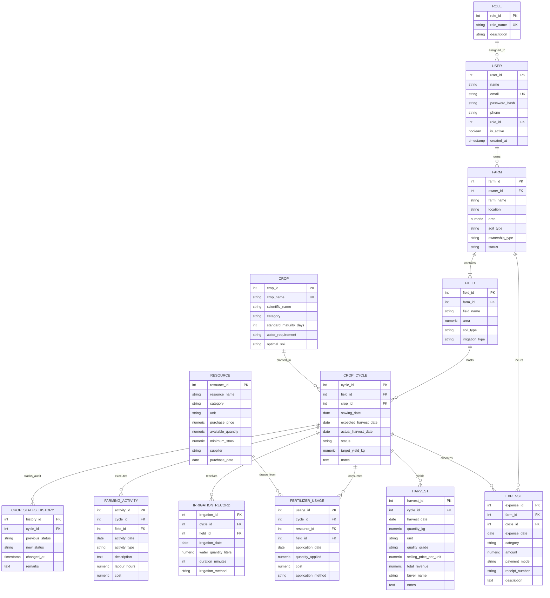

# 5. Database Design & Entity-Relationship (ER) Model
## Agriculture Resource and Farm Management System (AgriPulse)

---

## 1. Entity-Relationship (ER) Diagram (Mermaid)

---

## 2. Cardinality Analysis & Mapping to Relational Tables

| Relationship | Entities Involved | Cardinality | Relational Implementation |
| :--- | :--- | :--- | :--- |
| **Role Assignment** | `ROLE` (1) - `USER` (M) | 1:N | `users.role_id` -> `roles.role_id` (RESTRICT) |
| **Farm Ownership** | `USER` (1) - `FARM` (M) | 1:N | `farms.owner_id` -> `users.user_id` (CASCADE) |
| **Field Partitioning** | `FARM` (1) - `FIELD` (M) | 1:N | `fields.farm_id` -> `farms.farm_id` (CASCADE) |
| **Crop Cultivation** | `FIELD` (1) - `CROP_CYCLE` (M) | 1:N | `crop_cycles.field_id` -> `fields.field_id` (RESTRICT) |
| **Crop Type** | `CROP` (1) - `CROP_CYCLE` (M) | 1:N | `crop_cycles.crop_id` -> `crops.crop_id` (RESTRICT) |
| **Status Audit** | `CROP_CYCLE` (1) - `CROP_STATUS_HISTORY` (M) | 1:N | `crop_status_history.cycle_id` -> `crop_cycles.cycle_id` (CASCADE) |
| **Activity Execution** | `CROP_CYCLE` (1) - `FARMING_ACTIVITY` (M) | 1:N | `farming_activities.cycle_id` -> `crop_cycles.cycle_id` (CASCADE) |
| **Resource Consumption** | `RESOURCE` (1) - `FERTILIZER_USAGE` (M) | 1:N | `fertilizer_usages.resource_id` -> `resources.resource_id` (RESTRICT) |
| **Irrigation Events** | `CROP_CYCLE` (1) - `IRRIGATION_RECORD` (M) | 1:N | `irrigation_records.cycle_id` -> `crop_cycles.cycle_id` (CASCADE) |
| **Farm Expenditure** | `FARM` (1) - `EXPENSE` (M) | 1:N | `expenses.farm_id` -> `farms.farm_id` (CASCADE) |
| **Harvest Yields** | `CROP_CYCLE` (1) - `HARVEST` (M) | 1:N | `harvests.cycle_id` -> `crop_cycles.cycle_id` (RESTRICT) |

---

## 3. MongoDB Document Mapping Strategy

While the above 13 relational tables handle structured operational state, MongoDB handles the non-relational agronomic layer:

1. **`crop_observations`**: Correlated by `farmer_id`, `farm_id`, and `crop` name, storing dynamic morphological and symptom observations without requiring alter-table operations when new crops or sensors are introduced.
2. **`agricultural_advisories`**: Global agronomic knowledge base accessed through multi-tag querying and symptom search.
3. **`farming_notes`**: Dynamic farmer daily logs.
4. **`weather_records`**: Embedded micro-climate time-series documents.
